# CPE 334 Lab 5: Cloud Deployment and CI/CD

Source of the Lab 5 PDF `lab5_sec<section>_EN-009_P3.pdf` (#94). A writes Parts 0 to 2, B writes Parts 3 and 4 and their index rows; each reviews the other's Parts. Links first; a figure only where a link cannot show it. No secret, password, `DATABASE_URL` or personal email anywhere in this file or its figures.

Repository: https://github.com/songt888/event-registration-system (public). Abbreviations: `R-xx` handout requirement, `C-xx` handout check, `D-xx` decision in `docs/decisions.md`, `AC-xx`/`TEST-xx` acceptance criterion and test.

## Answer Part 0: Team and Evidence Index

| Item | Value |
|---|---|
| Team | EN-009_P3 (course portal prefix `s47a6b53b`), section `<section>` |
| Topic | Theme 3: Event Registration and Attendance System (same repo and app as the group project, starting from the accepted Sprint 1 release `v0.1.0-sprint1` at `12dcd3c`) |
| Student A | Kirakit Kingkaew, 67070503460, GitHub `songt888` |
| Student B | Nattakit Prasertsak, 67070503413, GitHub `stickkersz` |
| Repository | https://github.com/songt888/event-registration-system (public, R-12) |
| Submitted release | tag [`v0.1.2-lab5`](https://github.com/songt888/event-registration-system/releases/tag/v0.1.2-lab5) = `main` at [`04e8590`](https://github.com/songt888/event-registration-system/commit/04e85902befb951a01efd2e30236b6728352680c) (merge of release PR [#113](https://github.com/songt888/event-registration-system/pull/113)) |
| Public URL | https://s47a6b53b-4d7hbszvwq-as.a.run.app (Cloud Run service `s47a6b53b`, project `cpe-se-course-2026`, region `asia-southeast1`) |
| Commit it serves | `04e8590`: pipeline run [44898663334](https://github.com/songt888/event-registration-system/actions/runs/44898663334) deployed image `s47a6b53b:04e85902befb951a01efd2e30236b6728352680c` as revision `s47a6b53b-00004-44n`; the C-05 redeploy, run [44941012107](https://github.com/songt888/event-registration-system/actions/runs/44941012107) on the same commit, made `s47a6b53b-00005-5l7`, which serves 100% of traffic now. Image tag = full commit SHA (R-08) |
| Plan and rules | [`lab5-plan.md`](https://github.com/songt888/event-registration-system/blob/main/lab5-plan.md), Lab 5 section of [`AGENTS.md`](https://github.com/songt888/event-registration-system/blob/main/AGENTS.md), [`docs/labs/lab-05/deployment.md`](https://github.com/songt888/event-registration-system/blob/main/docs/labs/lab-05/deployment.md) |
| Board | GitHub Project "Event Registration - Lab 5" (Kanban: Backlog → Specified → Started → PR Review → Fixing → Done); every Lab 5 Issue and PR has the label [`lab5`](https://github.com/songt888/event-registration-system/issues?q=label%3Alab5) (R-10) |

**Contribution (R-09, R-11).** One Issue per step, a feature/fix/docs branch from `lab5-staging`, a PR into `lab5-staging` reviewed and merged by the other member; authors never approve their own PR. Release PRs go `lab5-staging` → `main`.

| Issue | Work | Author | Reviewer | PRs |
|---|---|---|---|---|
| [#85](https://github.com/songt888/event-registration-system/issues/85) | Lab 5 plan, decisions D-17 to D-25, rules | A | B | [#101](https://github.com/songt888/event-registration-system/pull/101) |
| [#86](https://github.com/songt888/event-registration-system/issues/86) | Course portal sign-in, team resources | A | B | portal only |
| [#87](https://github.com/songt888/event-registration-system/issues/87) | Cloud-ready app: API serves the UI, non-destructive demo seed (AC-52, AC-53) | A | B | [#96](https://github.com/songt888/event-registration-system/pull/96) |
| [#88](https://github.com/songt888/event-registration-system/issues/88) | Dockerfile, `.dockerignore`, compose (C-03) | B | A | [#97](https://github.com/songt888/event-registration-system/pull/97), [#99](https://github.com/songt888/event-registration-system/pull/99) |
| [#89](https://github.com/songt888/event-registration-system/issues/89) | CI `test-and-docker`, Dependabot (C-01) | B | A | [#98](https://github.com/songt888/event-registration-system/pull/98) |
| [#90](https://github.com/songt888/event-registration-system/issues/90) | `deploy.sh`, TEST-54, first deploy (C-04) | A | B | [#100](https://github.com/songt888/event-registration-system/pull/100), [#107](https://github.com/songt888/event-registration-system/pull/107) |
| [#91](https://github.com/songt888/event-registration-system/issues/91) | Ruleset, failing-check demo (C-02), portal link | A (ruleset, portal), B (C-02) | B, A | [#103](https://github.com/songt888/event-registration-system/pull/103) (closed, never merged) |
| [#92](https://github.com/songt888/event-registration-system/issues/92) | Deploy workflow, `release.sh`, smoke test, TEST-55, releases (C-06) | B | A | [#104](https://github.com/songt888/event-registration-system/pull/104), [#108](https://github.com/songt888/event-registration-system/pull/108), [#111](https://github.com/songt888/event-registration-system/pull/111), [#114](https://github.com/songt888/event-registration-system/pull/114); releases [#105](https://github.com/songt888/event-registration-system/pull/105), [#110](https://github.com/songt888/event-registration-system/pull/110), [#113](https://github.com/songt888/event-registration-system/pull/113) |
| [#93](https://github.com/songt888/event-registration-system/issues/93) | Persistence after restart and redeploy (C-05) | B | A | [#115](https://github.com/songt888/event-registration-system/pull/115) |
| [#94](https://github.com/songt888/event-registration-system/issues/94) | `deployment.md` final, this PDF | A (Parts 0-2), B (Parts 3-4) | cross | `<this PR>` |
| [#95](https://github.com/songt888/event-registration-system/issues/95) | Cost control under the course rules | B | A | [#102](https://github.com/songt888/event-registration-system/pull/102) |

Sync PRs [#106](https://github.com/songt888/event-registration-system/pull/106), [#109](https://github.com/songt888/event-registration-system/pull/109) and [#112](https://github.com/songt888/event-registration-system/pull/112) merge `main` back into `lab5-staging` (0 files changed) so each release PR is up to date, as the ruleset requires.

**Evidence index** (at least one row per rubric part).

| Rubric part | Artifact / direct link | IDs / version | Verification result |
|---|---|---|---|
| 1. CI and quality gate | [`ci-docker.yml`](https://github.com/songt888/event-registration-system/blob/v0.1.2-lab5/.github/workflows/ci-docker.yml); release PR [#113](https://github.com/songt888/event-registration-system/pull/113), run [44891329483](https://github.com/songt888/event-registration-system/actions/runs/44891329483) | C-01, R-05; `28daa86` | `test-and-docker` passed: 14 test files, 69 of 69 tests, TEST-54 6/6, TEST-55 10/10, Docker build |
| 1. CI and quality gate | Ruleset `lab5-protect-main-and-staging` (Figures 1 and 2) | R-06; ruleset 27724790 | Active on `main` and `lab5-staging`; PR, 1 approval, `test-and-docker` up to date required; empty bypass list |
| 1. CI and quality gate | PR [#103](https://github.com/songt888/event-registration-system/pull/103) from `lab5/temp-failing-check`, run [44770720573](https://github.com/songt888/event-registration-system/actions/runs/44770720573) (Figure 3) | C-02, R-06; `223c6ed` | Check failed; merge blocked; PR closed unmerged, branch deleted |
| 2. Docker and config | [`Dockerfile`](https://github.com/songt888/event-registration-system/blob/v0.1.2-lab5/Dockerfile), [`.dockerignore`](https://github.com/songt888/event-registration-system/blob/v0.1.2-lab5/.dockerignore), [`docker-compose.yml`](https://github.com/songt888/event-registration-system/blob/v0.1.2-lab5/docker-compose.yml); PR [#97](https://github.com/songt888/event-registration-system/pull/97) | C-03, R-01; `04e8590` | Fresh clone: `docker compose up --build`, migrate exited 0, app 200 on `/api/health` and `/`, sign-in and events read from the database (Listing 1) |
| 2. Docker and config | [`.env.example`](https://github.com/songt888/event-registration-system/blob/v0.1.2-lab5/.env.example), env var table in [`deployment.md`](https://github.com/songt888/event-registration-system/blob/v0.1.2-lab5/docs/labs/lab-05/deployment.md#2-environment-variables) | R-02, R-12; `04e8590` | Only `.env.example` is tracked; no `.env` in the image; secrets only in Secret Manager |
| 3. GCP deployment | Public URL https://s47a6b53b-4d7hbszvwq-as.a.run.app; first deploy [#90](https://github.com/songt888/event-registration-system/issues/90) (execution `s47a6b53b-migrate-gxtfx`, revision `s47a6b53b-00003-gwh`); Figures 4 to 7 | C-04, R-03; `04e8590` | Sign-in, organizer and participant views, and the duplicate-registration rule work on the cloud |
| 3. GCP deployment | [#93](https://github.com/songt888/event-registration-system/issues/93), PR [#115](https://github.com/songt888/event-registration-system/pull/115), [`l5-08-persistence.md`](https://github.com/songt888/event-registration-system/blob/lab5-staging/docs/labs/lab-05/l5-08-persistence.md); run [44941012107](https://github.com/songt888/event-registration-system/actions/runs/44941012107); Figures 8 to 12 | C-05, R-04; revisions `-00004-44n` to `-00005-5l7` | The same two registrations stay ACTIVE after a redeploy and after a new container (12:36:06 restart) |
| 3. GCP deployment | [`deployment.md` sections 2 and 5](https://github.com/songt888/event-registration-system/blob/lab5-staging/docs/labs/lab-05/deployment.md), PR [#102](https://github.com/songt888/event-registration-system/pull/102), [#95](https://github.com/songt888/event-registration-system/issues/95) | R-03; `deploy.sh` 0 to 1 instances | Secrets only in Secret Manager; smallest Cloud SQL tier; scale to zero |
| 4. Release pipeline | [#92](https://github.com/songt888/event-registration-system/issues/92): PRs [#104](https://github.com/songt888/event-registration-system/pull/104), [#108](https://github.com/songt888/event-registration-system/pull/108), [#111](https://github.com/songt888/event-registration-system/pull/111) into `lab5-staging`; release PR [#113](https://github.com/songt888/event-registration-system/pull/113) into `main` | C-06, R-07, R-09, R-11; `04e8590` | Each PR reviewed by the other member and passed `test-and-docker` |
| 4. Release pipeline | Deploy run [44898663334](https://github.com/songt888/event-registration-system/actions/runs/44898663334) (Figures 13, 14); running revision (Figures 15 to 18); [`deployment.md` sections 6 and 7](https://github.com/songt888/event-registration-system/blob/lab5-staging/docs/labs/lab-05/deployment.md), PR [#114](https://github.com/songt888/event-registration-system/pull/114) | C-06, R-08; image tag `04e85902befb951a01efd2e30236b6728352680c` | Pipeline passed; revision `s47a6b53b-00005-5l7` runs digest `484ebb711eee...`, the amd64 image tagged with the release commit; rollback procedure written |

## Answer Part 1: CI and Quality Gate

**CI workflow (R-05).** [`.github/workflows/ci-docker.yml`](https://github.com/songt888/event-registration-system/blob/v0.1.2-lab5/.github/workflows/ci-docker.yml), job `test-and-docker`, runs on every Pull Request into `lab5-staging` and `main`. Steps: a PostgreSQL 16 service with the test database, `npm ci`, `npm run migrate`, `npm test` (unit tests and API tests against the real database), the offline script tests TEST-54 (`deploy.sh`) and TEST-55 (`release.sh`, `smoke_test.py`, `deploy.yml` settings check), `npm run build`, then `docker build`. Actions are pinned to full commit SHAs; [`.github/dependabot.yml`](https://github.com/songt888/event-registration-system/blob/v0.1.2-lab5/.github/dependabot.yml) proposes updates into `lab5-staging`. E2E (Playwright) is not part of the required check (D-23); it runs locally.

**Passing PR with meaningful results (C-01).** Release PR [#113](https://github.com/songt888/event-registration-system/pull/113) (`lab5-staging` → `main`): run [44891329483](https://github.com/songt888/event-registration-system/actions/runs/44891329483) on `28daa86` passed: 14 test files and 69 of 69 tests, then TEST-54 6 of 6 and TEST-55 10 of 10 PASS lines, then the Docker build. The first CI run, on the CI PR itself, is [#98](https://github.com/songt888/event-registration-system/pull/98) / run [44699862042](https://github.com/songt888/event-registration-system/actions/runs/44699862042) on `6a0e3e3` (69 of 69).

**Required check on `main` (R-06).** Ruleset `lab5-protect-main-and-staging` (id 27724790) applies to `main` and `lab5-staging`: a Pull Request with 1 approval is required, the status check `test-and-docker` must pass on an up-to-date branch, force pushes and deletion are blocked, and the bypass list is empty, so nobody can merge past a failed check. Settings pages are only visible to repository admins, so Figures 1 and 2 show them. B checked the same rules through the API on [#91](https://github.com/songt888/event-registration-system/issues/91#issuecomment-7047271118).


Figure 1. R-06: ruleset `lab5-protect-main-and-staging` is Active, its bypass list is empty, and it targets `main` and `lab5-staging`. GitHub repository settings, ruleset 27724790, captured 2026-11-21 on `main` `04e8590`.


Figure 2. R-06: the same ruleset requires a Pull Request before merging and the status check `test-and-docker` (GitHub Actions), with "Require branches to be up to date before merging" on; force pushes are blocked. Ruleset 27724790, captured 2026-11-21.

**Failing Pull Request with the merge blocked (C-02).** B opened PR [#103](https://github.com/songt888/event-registration-system/pull/103) "DO NOT MERGE: C-02 failing-check demo" from the temporary branch `lab5/temp-failing-check`, which adds one test that fails on purpose. `test-and-docker` failed on `223c6ed` (run [44770720573](https://github.com/songt888/event-registration-system/actions/runs/44770720573)), and the ruleset blocked the merge (Figure 3). The PR was closed without merging and the branch deleted; `223c6ed` never reached `lab5-staging` or `main`, so the released app was never broken.


Figure 3. C-02 (R-06): PR #103 from the temporary branch `lab5/temp-failing-check`; the required check `test-and-docker` failed and merging is blocked. Commit `223c6ed`, run 44770720573.

## Answer Part 2: Docker and Reproducible Configuration

**Image (R-01).** [`Dockerfile`](https://github.com/songt888/event-registration-system/blob/v0.1.2-lab5/Dockerfile) has three stages on Node 24 (D-19): build the React UI, build the Express API with Prisma, then a runtime stage that runs as the non-root user `node` and serves the built UI and the API on port 3000 from one container (D-18). [`.dockerignore`](https://github.com/songt888/event-registration-system/blob/v0.1.2-lab5/.dockerignore) keeps `.env` files (except `.env.example`), `node_modules`, build output, E2E tests, docs and Git data out of the build context. [`docker-compose.yml`](https://github.com/songt888/event-registration-system/blob/v0.1.2-lab5/docker-compose.yml) runs the same image three ways: `db` (PostgreSQL 16 with a volume), `migrate` (`npm run migrate -w server && npm run seed:demo -w server`, the same command as the Cloud Run job) and `app`, which starts only after `migrate` succeeds. Made in [#88](https://github.com/songt888/event-registration-system/issues/88) by B, reviewed by A from a fresh clone in [#97](https://github.com/songt888/event-registration-system/pull/97); the CI job builds the image on every PR.

**Fresh build and the running container with its database (C-03).** B cloned the release tag into an empty folder on 2026-11-22 and ran the README commands exactly: `cp .env.example .env`, then `docker compose up --build`, with no override file and no other flags. Listing 1 is the output, shortened to the lines that matter (the full log is linked under it). A had run the same check on 2026-11-21 with an override file that hid the `db` port, because a local development database held port 5432; we replaced that run with this plain one so that anyone can repeat Listing 1 from the README.

Listing 1. C-03 (R-01, R-02): fresh clone of `v0.1.2-lab5` (`04e8590`), `cp .env.example .env`, `docker compose up --build`. Migration and demo seed exit 0; the app answers on :3000; a synthetic account signs in and reads events from PostgreSQL; only `.env.example` is tracked and the image has no `.env` and runs as `node`. Full log: [`c03-fresh-clone.txt`](https://github.com/songt888/event-registration-system/blob/lab5-staging/docs/labs/lab-05/pdf/c03-fresh-clone.txt).

```text
$ git rev-parse HEAD
04e85902befb951a01efd2e30236b6728352680c
$ cp .env.example .env
$ docker compose up --build
 Container event-registration-system-db-1 Healthy
migrate-1  | All migrations have been successfully applied.
migrate-1  | Demo seed done: missing demo data created, nothing deleted or changed.
 Container event-registration-system-migrate-1 Exited
 Container event-registration-system-app-1 Started
app-1      | API listening on http://localhost:3000
$ docker compose ps -a
SERVICE   STATE     STATUS
app       running   Up 11 seconds
db        running   Up 19 seconds (healthy)
migrate   exited    Exited (0) 12 seconds ago
$ curl http://localhost:3000/api/health  ->  200 {"status":"ok"}
$ curl http://localhost:3000/            ->  200
$ curl http://localhost:3000/api/me      ->  401 (no session)
$ curl -c jar -d '{"email":"participant1@example.com","password":"<SEED_PASSWORD from .env>"}' .../api/auth/login
{"user":{"id":"7f61bce1-...","name":"Participant One","role":"PARTICIPANT"}}
$ curl -b jar http://localhost:3000/api/events   (titles)
Intro to Git workshop
Career talk (small room)
Robotics club open day
$ git ls-files | grep -E '(^|/)\.env'
.env.example
$ docker run --rm --entrypoint sh eventreg:local -c 'find / -name .env ...; whoami'
node
$ docker compose down -v
```

**Configuration from the environment, no secret committed (R-02, R-12).** Every setting is read from environment variables: [`.env.example`](https://github.com/songt888/event-registration-system/blob/v0.1.2-lab5/.env.example) lists them with local placeholders only (`SEED_PASSWORD=change-me`, the local `app:app` database), `.env` and `server/.env` are gitignored, and `.dockerignore` keeps them out of the image. The table in [`deployment.md` section 2](https://github.com/songt888/event-registration-system/blob/v0.1.2-lab5/docs/labs/lab-05/deployment.md#2-environment-variables) gives each variable's purpose, whether it is secret, and its local and cloud source. On Cloud Run, `DATABASE_URL` and `SEED_PASSWORD` come only from the portal's Secret Manager secrets `s47a6b53b-database-url` and `s47a6b53b-demo-password` (`--update-secrets`); the other settings are set with `--update-env-vars` (`NODE_ENV=production`, `COOKIE_SECURE=true`, `SESSION_TTL_MINUTES=60`, `TZ=Asia/Bangkok`). The GitHub environment `demo` holds only non-secret variables (project, region, WIF provider and service account, `APP_PORT`, `MIGRATE_COMMAND`) and 0 secrets; the pipeline signs in through Workload Identity Federation with no key file. GitHub secret scanning push protection is on for the repository.

## Answer Part 3: GCP Deployment and Persistence

**Resources (R-03).** The course portal created every cloud resource with the team prefix `s47a6b53b` in project `cpe-se-course-2026`, region `asia-southeast1`: Cloud Run service `s47a6b53b`, migration job `s47a6b53b-migrate`, Cloud SQL for PostgreSQL `s47a6b53b-pg` (smallest tier), Artifact Registry repository `s47a6b53b`, and the Secret Manager secrets `s47a6b53b-database-url` and `s47a6b53b-demo-password`. We created none of them (D-25); [`deployment.md` section 4](https://github.com/songt888/event-registration-system/blob/lab5-staging/docs/labs/lab-05/deployment.md) lists them.

**First deploy ([#90](https://github.com/songt888/event-registration-system/issues/90), C-04).** A ran [`deploy/deploy.sh`](https://github.com/songt888/event-registration-system/blob/v0.1.2-lab5/deploy/deploy.sh) (PR [#100](https://github.com/songt888/event-registration-system/pull/100), TEST-54) in Cloud Shell on `main` `04e8590`. Cloud Shell's `docker push` failed three times with `connect: connection refused`, and `set -e` stopped the script before any cloud change. Workaround: Deploy run [44897414447](https://github.com/songt888/event-registration-system/actions/runs/44897414447) pushed the image, then `DRY_RUN=0 bash deploy/deploy.sh --demo` used it by digest. Migration and demo seed ran as job execution `s47a6b53b-migrate-gxtfx`, and revision `s47a6b53b-00003-gwh` took 100% of traffic. Read-only smoke check: `/api/health` 200, `/` 200, `/api/me` 401, `/api/events` 401.

**C-04 on the public URL** https://s47a6b53b-4d7hbszvwq-as.a.run.app (synthetic demo accounts; captures from [#90](https://github.com/songt888/event-registration-system/issues/90)):

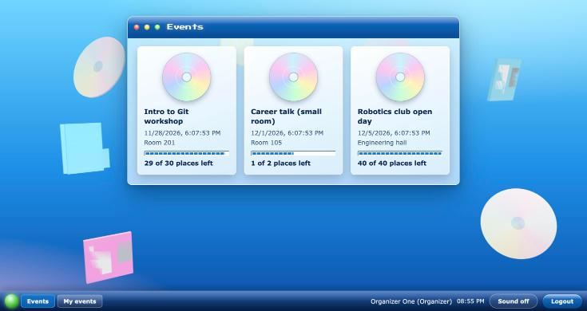

Figure 4. C-04 (R-03): Organizer One signed in on the public URL; the published events with places left.

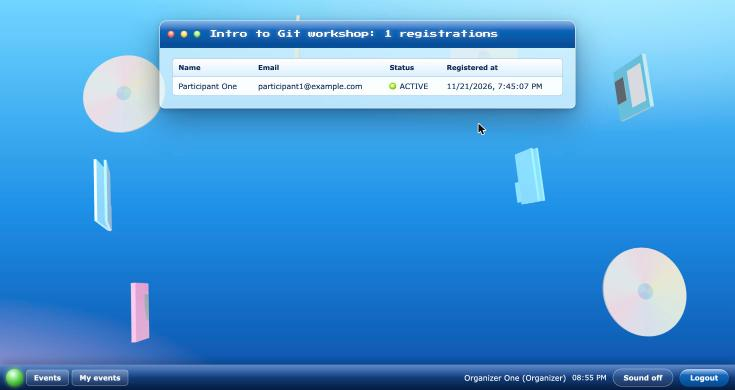

Figure 5. C-04: Organizer One sees the registrations of their own event, Intro to Git workshop: Participant One, ACTIVE.

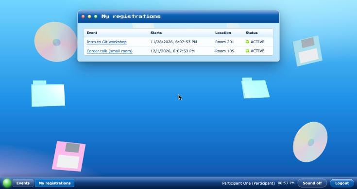

Figure 6. C-04: Participant One's My registrations: Intro to Git workshop and Career talk (small room), both ACTIVE.

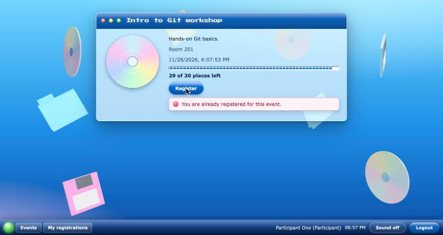

Figure 7. C-04, business rule on the cloud: a second registration for the same event is refused with "You are already registered for this event." and the count stays at 29 of 30 places left.

**Persistence after redeploy and restart (C-05, R-04;** [#93](https://github.com/songt888/event-registration-system/issues/93), PR [#115](https://github.com/songt888/event-registration-system/pull/115), [`l5-08-persistence.md`](https://github.com/songt888/event-registration-system/blob/lab5-staging/docs/labs/lab-05/l5-08-persistence.md)**).** Participant One's two registrations were checked before and after a redeploy, and again after Cloud Run started a new container. Times are +07 on 2026-11-22.

| Step | Time | Revision at 100% | Result | Figure |
|---|---|---|---|---|
| Before | 02:25 | `s47a6b53b-00004-44n` | Intro to Git workshop and Career talk (small room), both ACTIVE | 8 |
| Redeploy | 02:27 to 02:29 | new `s47a6b53b-00005-5l7` | Deploy run [44941012107](https://github.com/songt888/event-registration-system/actions/runs/44941012107) (#6) on `main` `04e8590`: image rebuilt, migration and `seed:demo` (execution `s47a6b53b-migrate-lvnlb`), new revision at 100% | 9 |
| After redeploy | 02:29 | `s47a6b53b-00005-5l7` | the same two registrations, both ACTIVE | 10 |
| Restart | 12:36 | `s47a6b53b-00005-5l7` | Cloud Run had scaled the service to 0 while idle (no request from 03:26:04 to 12:36:06); logs: "Starting new instance. Reason: AUTOSCALING", then "API listening". No Console change, no new image | 11 |
| After restart | 12:38 | `s47a6b53b-00005-5l7` | signed in again on the new container: the same two registrations, both ACTIVE | 12 |

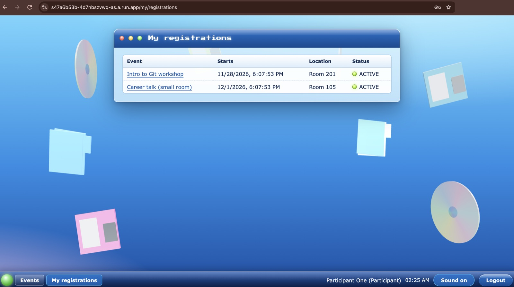

Figure 8. C-05 before: Participant One's My registrations on the public URL, with the clock visible, 02:25.

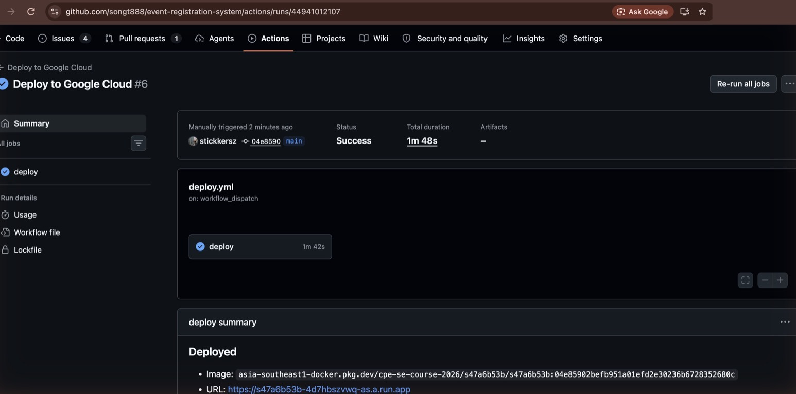

Figure 9. C-05 redeploy: Deploy run 44941012107 (#6) summary with image `s47a6b53b:04e85902befb951a01efd2e30236b6728352680c` and the service URL.

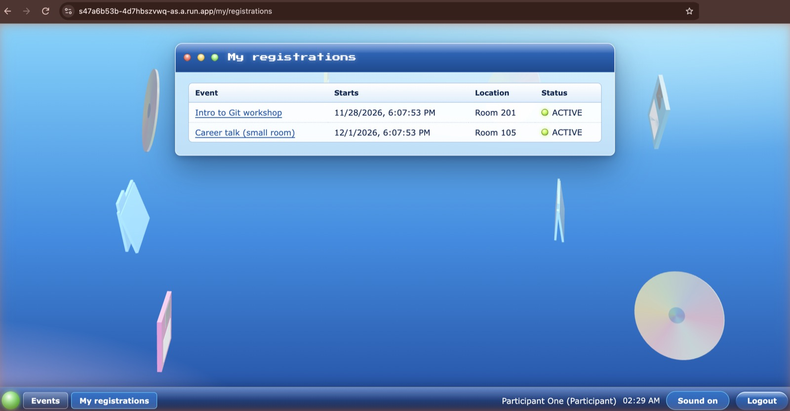

Figure 10. C-05 after the redeploy (revision `s47a6b53b-00005-5l7`): the same two registrations, 02:29.

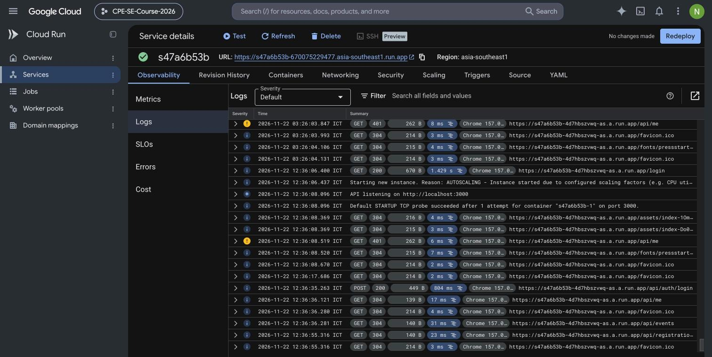

Figure 11. C-05 restart: Cloud Run service logs (Console, read-only). No request from 03:26:04 to 12:36:06; at 12:36:06 "Starting new instance. Reason: AUTOSCALING", at 12:36:08 "API listening on http://localhost:3000", then the sign-in at 12:36:35.

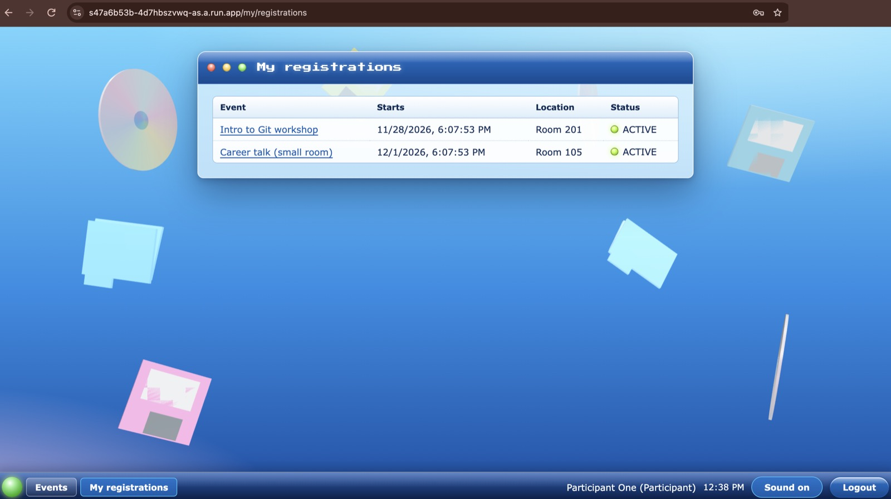

Figure 12. C-05 after the restart: signed in again on the new container, the same two registrations, 12:38.

**Why the data survives.** The data lives in Cloud SQL `s47a6b53b-pg`, not in the container. The migration step is `prisma migrate deploy`, and the deployed seed is `seed:demo`, which adds missing demo data and deletes or changes nothing (D-20), so neither a new revision nor a new container touches existing registrations.

## Answer Part 4: Repeatable Release Pipeline

**The labelled change (R-07, R-10).** Issue [#92](https://github.com/songt888/event-registration-system/issues/92) (label `lab5`): the deploy workflow, `deploy/release.sh`, `deploy/smoke_test.py` (TEST-55), and one visible change: the sign-in page says "Demo running on Google Cloud Run." (checked in the live bundle).

**Path through the gates (C-06, R-09, R-11).**

| Step | Link | Gate |
|---|---|---|
| PR into `lab5-staging` | [#104](https://github.com/songt888/event-registration-system/pull/104) (B), approved by A with a specific check: A traced the route (`server/src/app.ts:15`, `client/src/auth.tsx:24`, TEST-03) and confirmed B's fix of the smoke path from `/api/auth/me` to `/api/me` | `test-and-docker` passed |
| Fix PR | [#108](https://github.com/songt888/event-registration-system/pull/108) (B): settings check under `bash -e`, AC-55 (h), red then green commits; approved by A | `test-and-docker` passed |
| Portal workflow | [#111](https://github.com/songt888/event-registration-system/pull/111) (A): the portal's `deploy.yml` kept unchanged; B requested changes first, then approved | `test-and-docker` passed |
| Release PR into `main` | [#113](https://github.com/songt888/event-registration-system/pull/113) (A opened, B approved and merged), commit `04e8590`, tag `v0.1.2-lab5` | ruleset: 1 approval, `test-and-docker` on an up-to-date branch |
| Pipeline | `Deploy to Google Cloud` run [44898663334](https://github.com/songt888/event-registration-system/actions/runs/44898663334) (#5): sign-in without a key (Workload Identity Federation), build and push `s47a6b53b:04e85902befb951a01efd2e30236b6728352680c`, migration `s47a6b53b-migrate-6lbkt`, deploy | all steps passed (Figures 13, 14) |
| Running revision | Run #5 made revision `s47a6b53b-00004-44n`. The C-05 redeploy, run [44941012107](https://github.com/songt888/event-registration-system/actions/runs/44941012107) (#6, same commit `04e8590`), replaced it with `s47a6b53b-00005-5l7`, which serves 100% now | Figures 15 to 18 |

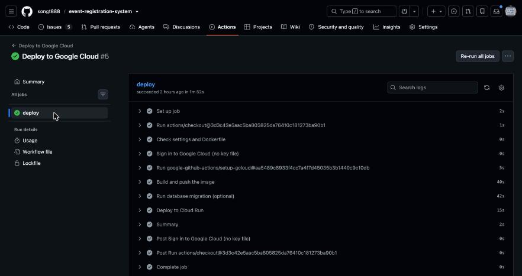

Figure 13. C-06: Deploy run 44898663334 (#5) on `main` `04e8590`, every step passed.

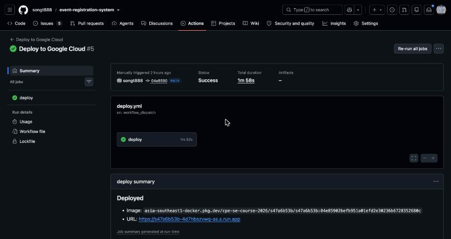

Figure 14. C-06: the same run's summary: image tagged with the full commit SHA `04e85902befb951a01efd2e30236b6728352680c` (R-08) and the service URL.

**Running revision = release commit (C-06, R-08).** The Console shows a revision's image by digest, so Figures 15 to 18 link the serving revision back to the commit through Artifact Registry ([`deployment.md` section 6.3](https://github.com/songt888/event-registration-system/blob/lab5-staging/docs/labs/lab-05/deployment.md)).

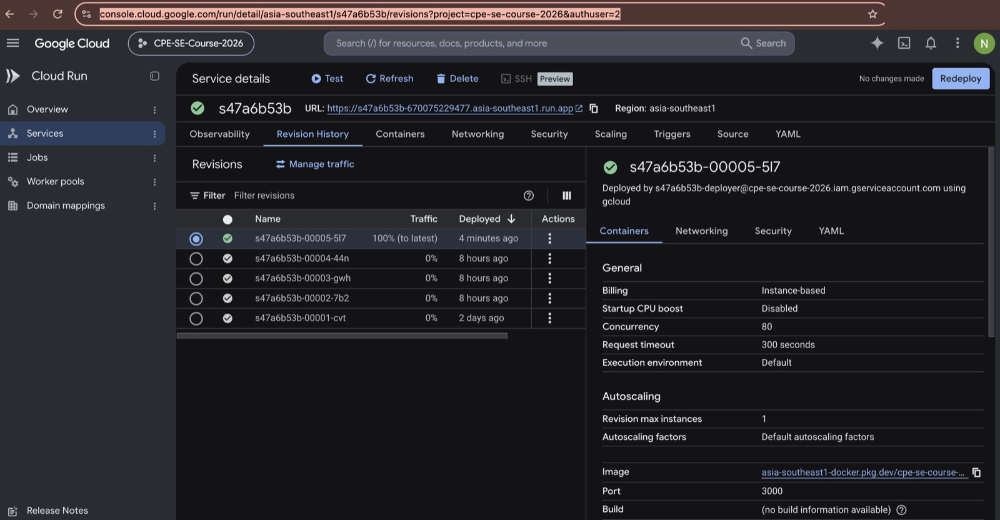

Figure 15. Cloud Run Revision History: `s47a6b53b-00005-5l7` serves 100% of traffic, max instances 1, deployed by `s47a6b53b-deployer`.

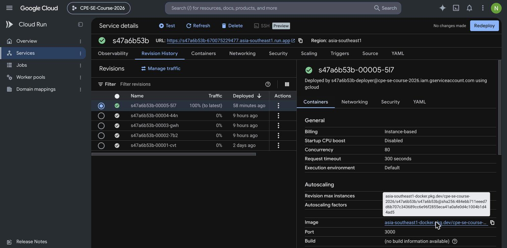

Figure 16. The same revision's image: `s47a6b53b@sha256:484ebb711eee...`.

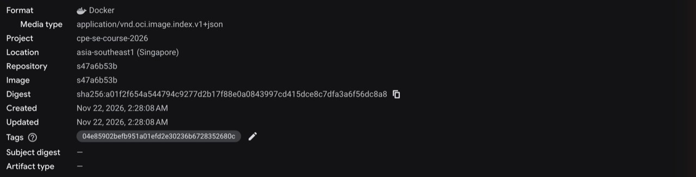

Figure 17. Artifact Registry: image index `a01f2f654a54...` carries the tag `04e85902befb951a01efd2e30236b6728352680c`, the release commit.

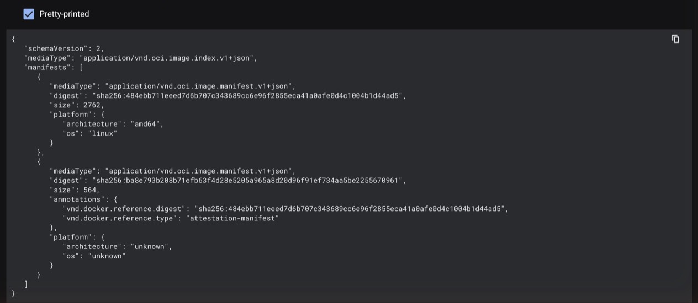

Figure 18. That index lists `484ebb711eee...` as its `linux/amd64` image, so the running revision is the release commit `04e8590`. Run 44941012107's log shows the same digest (`exporting manifest sha256:484ebb711eee...`).

**Earlier runs, kept honest.** Runs [44798044685](https://github.com/songt888/event-registration-system/actions/runs/44798044685), [44885988467](https://github.com/songt888/event-registration-system/actions/runs/44885988467) and [44891493206](https://github.com/songt888/event-registration-system/actions/runs/44891493206) on the three release commits stopped before any cloud call, because the environment `demo` had no variables yet (the WIF sign-in failed, then the settings check stopped as designed). The release and rollback procedure is in [`deployment.md` sections 6 and 7](https://github.com/songt888/event-registration-system/blob/lab5-staging/docs/labs/lab-05/deployment.md) (PR [#114](https://github.com/songt888/event-registration-system/pull/114)): roll back by sending traffic to an earlier revision or redeploying an earlier release image, never by resetting the database.

## AI use

Claude Code (Claude Opus) helped draft Parts 0 to 2, captured Figures 1 and 2 for A, and ran the first fresh-clone C-03 check (replaced by B's plain re-run); A checked every link and figure. Claude Code (Claude Opus) helped B draft Parts 3 and 4, crop the evidence screenshots, re-run C-03 with the plain README command and check every claim against the runs, Issues and Console pages; B checked every link and figure.
