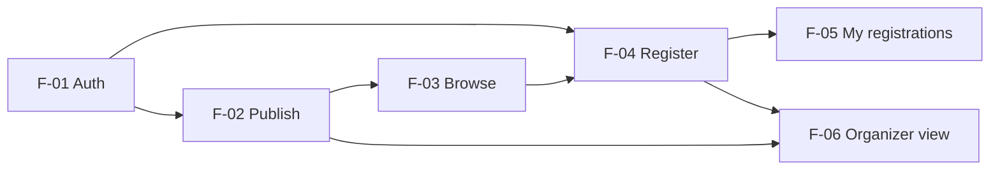

# Three-Sprint Plan

Event Registration and Attendance System, CPE 334 group project, Theme 3.
Feature IDs from `docs/features.md`; requirement IDs from `docs/srs.md`. Owners and order of Sprint 1 work: `docs/sprints/sprint-1/issue-plan.md`.

## 1. Sprint overview
| Sprint | Dates | Goal | Features | Checkpoint |
|---|---|---|---|---|
| 1 | 6 to 8 Nov 2026 | A small working domain slice: real login with two roles, an organizer publishes an event, a participant registers within capacity, both see the persisted result, with backend permissions and tests | F-01, F-02, F-03, F-04, F-05, F-06 | Deliverable 1, 8 Nov; tag `v0.1.0-sprint1` |
| 2 | 9 to 29 Nov 2026 | Core expansion: participants cancel, organizers manage their events, registration deadlines; check-in started | F-07, F-08, F-09 (F-10 started) | Deliverable 2, 29 Nov; deployed release candidate |
| 3 | 9 Nov to 13 Dec 2026 (overlaps S2, finishes after exams) | Attendance and reporting, then hardening: check-in, attendance record and report, organizer summary, performance, usability, regression | F-10, F-11, F-12, F-13 | Progress at 29 Nov; final release 13 Dec |

Labs 5 to 7 run on the same product: Lab 5 deploys the Sprint 1 release (15 Nov), Lab 6 is cross-team UAT (22 Nov), Lab 7 is a maintenance change (29 Nov). Their work is planned inside Sprints 2 and 3 but kept as separate Issues and PRs.

## 2. Sprint 1: small working slice

### 2.1 Features and outcome
| Feature | Covers | Completion outcome |
|---|---|---|
| F-01 Authentication foundation | FR-01, FR-02, FR-03; NFR-01, NFR-02, NFR-03, NFR-07 | Seeded users log in and out; `/api/me` returns the user; protected routes return 401 without a session and 403 for the wrong role |
| F-02 Publish event | FR-04, FR-15; BR-01, BR-09 | An organizer creates a DRAFT, sees it in My events and publishes it; invalid capacity or start time is rejected; non-owners cannot publish or read drafts |
| F-03 Browse events | FR-05 | Signed-in users see PUBLISHED events with remaining places; drafts never appear |
| F-04 Register for event | FR-06; BR-02, BR-03, BR-04; NFR-04 | A participant registers; full, duplicate, draft and started events are rejected; parallel requests for the last place give exactly one success |
| F-05 My registrations | FR-07; BR-05 | A participant sees their own registrations and cannot read another participant's |
| F-06 Event registrations (organizer) | FR-08; BR-05 | An organizer sees who registered for their own event and nobody else's |

Sprint 1 is done when all six features meet the Product Definition of Done, the full suite passes on the release commit, and the reviewed release PR is merged to `main` and tagged.

### 2.2 Why this scope
- It is the theme's required Sprint 1 slice: publish with positive capacity, register, view own registration, organizer views their event's registrations, with capacity, one active registration and the last-place race enforced.
- It proves every layer once (UI, API, service, database) and the authentication and authorization foundation that every later feature reuses.
- It contains the two hardest rules early (capacity under concurrency, ownership), so later sprints build on tested ground.
- The DRAFT state (D-07) is the one real state transition in Sprint 1. Cancellation, deadlines and check-in are left out because each adds new states and rules that need their own contracts; they are not needed to prove the slice.
- Six small features fit two students in three days because each is one vertical slice with a contract written first; the plan in `issue-plan.md` runs them in two parallel lanes.

### 2.3 Dependencies

All Sprint 1 features also depend on Issue 3 (project skeleton, schema, seed, test runner). F-02 can be written before F-01 is merged; only its routes wait for `requireSession` and `requireRole`.

### 2.4 NFRs established and verified in Sprint 1
| NFR | Verified by | When |
|---|---|---|
| NFR-01, NFR-03 | API tests for 401, 403 and 404 on every protected route | each feature PR, again in the 9.4 QA run |
| NFR-02 | DB test of the stored hash, response tests | F-01 |
| NFR-04 | TEST-15 concurrency test, run five times | F-04, 9.4 QA run |
| NFR-06 | restart the server, read the same data | 9.4 QA run |
| NFR-07 | error-shape tests | each feature PR |
| NFR-08 | fresh clone following the README, commands counted | Issue 3 review, 9.4 QA run |
| NFR-09 | E2E TEST-11 + checklist on 5 screens | 9.4 QA run |

## 3. Sprint 2: core expansion
| Feature | Covers | Depends on | Completion outcome |
|---|---|---|---|
| F-07 Cancel registration | FR-09, BR-07 | F-04, F-05 | A participant cancels their ACTIVE registration; the place is freed and they can register again (BR-07); exact time limit set in the S2 contract |
| F-08 Manage event | FR-10; D-03 | F-02, F-06 | The owner edits details, changes capacity (never below current ACTIVE count), closes or cancels the event; cancelled events reject registration |
| F-09 Registration deadline | FR-11, BR-06 | F-02, F-04 | Registration after the event's deadline is rejected (BR-06); deadline rules set in the S2 contract |
| F-10 Check-in (start) | FR-12, BR-08 | F-06 | Contract written and the check-in rule implemented and tested if time allows; finished in Sprint 3 |

Sprint 2 also carries Lab 5 (Docker, CI/CD, GCP deployment of the Sprint 1 release), so every Sprint 2 PR runs through CI. Outcome by 29 Nov: all Sprint 2 features merged, reviewed and deployed in a release candidate on GCP.

## 4. Sprint 3: completion and hardening
| Feature | Covers | Depends on | Completion outcome |
|---|---|---|---|
| F-10 Check-in | FR-12, BR-08 | F-06, F-07 | The owning organizer checks in an ACTIVE registration once, only within the event window |
| F-11 Attendance record and report | FR-13 | F-10 | Per-event attendance list and counts (registered, checked in, no-show) |
| F-12 Organizer summary dashboard | FR-14 | F-11 | Organizer sees totals across their events |
| F-13 Hardening, UX, regression | NFR-05, NFR-06, NFR-09; login rate limiting | all | NFR-05 measured at p95 < 500 ms with 1,000 events; full regression suite; UAT defects from Lab 6 fixed and re-tested |

Outcome: Sprint 3 contracts and working progress shown at Deliverable 2 (29 Nov) with an explicit remaining-work list; complete product released and deployed by 13 Dec.

## 5. Coverage check
Every baseline feature F-01 to F-13 appears in exactly one sprint as its completion sprint (F-10 starts in Sprint 2 and completes in Sprint 3). Every FR, BR and important NFR maps to at least one of these features in `docs/traceability.md`. Scope changes are recorded there and in `docs/decisions.md`, never by silently moving a feature.

## 6. Risks
| Risk | Effect | Response |
|---|---|---|
| Three days for Sprint 1 | features not finished | two parallel lanes; UI polish is cut first, never backend tests or contracts |
| Last-place race is hard to test reliably | flaky TEST-15 | row lock design (D-10), sequential integration files (D-14), five repeated runs |
| Labs 5 to 7 compete with Sprint 2 time | Sprint 2 late | lab work as separate small Issues; Sprint 2 contracts written in the week of 9 Nov |
| Final exams 1 to 11 Dec | Sprint 3 stalls | product substantially complete by 29 Nov; only bounded work left for December |

## 7. Version history
| Version | Date | Change | Author | Reviewer |
|---|---|---|---|---|
| 1.0 | 2026-11-07 | First three-sprint plan for Deliverable 1 (Issue #15) | B (stickkersz) | A (songt888) |
